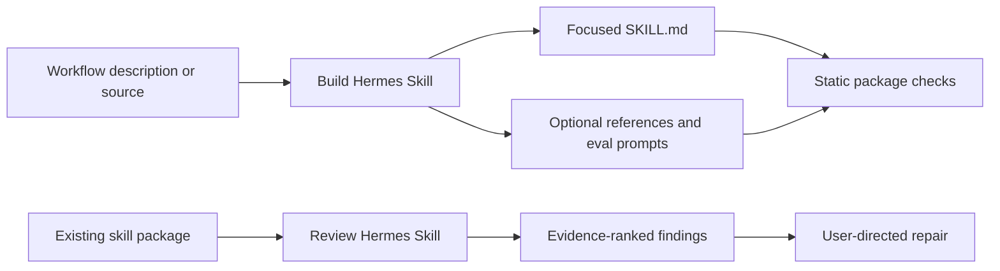

# Architecture

## Product boundary

Hermes Creator Forge is a skills-only Agent Plugin. The language model is provided by the host. The repository packages workflow instructions, examples, a local static validator, and CI. It does not ship an app server, MCP integration, credentials, telemetry, or model SDK.

## Components

| Component | Responsibility | Side effects |
| --- | --- | --- |
| `build-hermes-skill` | Turn one repeatable job and source material into a Hermes skill plus eval prompts | Creates files only when the user requests delivery; never installs or publishes by default |
| `review-hermes-skill` | Inspect an existing skill and report evidence-ranked findings | Read-only by default; edits require a separate request |
| `host-workspace-operator` | Route file/repository tasks to host-native capabilities | Host controlled; write/patch and mutating shell are explicit mutation actions |
| `sandbox-python-executor` | Run deterministic validation or file checks when useful | Executes only the requested local verification; does not create a remote runtime |
| `scripts/validate_skills.py` | Check repository package shape and basic safety/metadata invariants | Read-only |
| GitHub Actions | Run package checks and unit tests | Read-only `contents` permission |

## Data flow

Conversation content is handled by the host model under the host's own data controls. The plugin itself makes no network requests. Generated file paths are selected in the user's workspace; the skill does not assume a particular home directory.

## Package formats

- Root `plugin.json` is the portable Agent Plugin manifest.
- `extensions.com.openai` in the root manifest carries OpenAI presentation settings; it takes precedence over `.codex-plugin/plugin.json`, which remains a compatibility fallback.
- `.agents/plugins/marketplace.json` is a local repository marketplace catalog that points to the checkout root. It is not an official public marketplace entry.
- Every plugin skill is a direct folder under `skills/` with its own `SKILL.md`.
- Hermes can consume those skill folders by manual copy; the OpenAI plugin manifests do not register a Hermes Hub or Hermes plugin listing.
- `assets/` contains the square, self-contained light/dark marks and compact icon.

## Deliberate exclusions

No account management, service calls, autonomous skill installation, destructive editing, remote execution, generated arbitrary scripts, or public publishing. Those add trust and deployment requirements that the current use case does not need.
